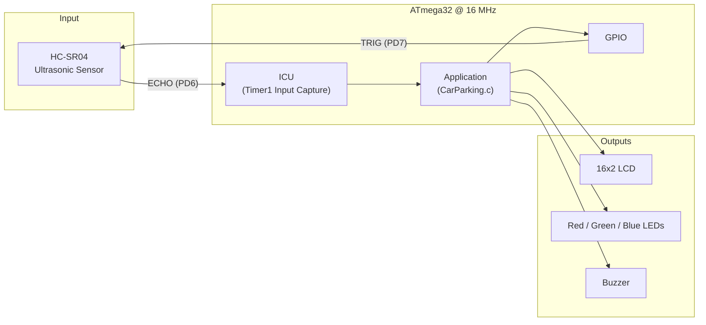
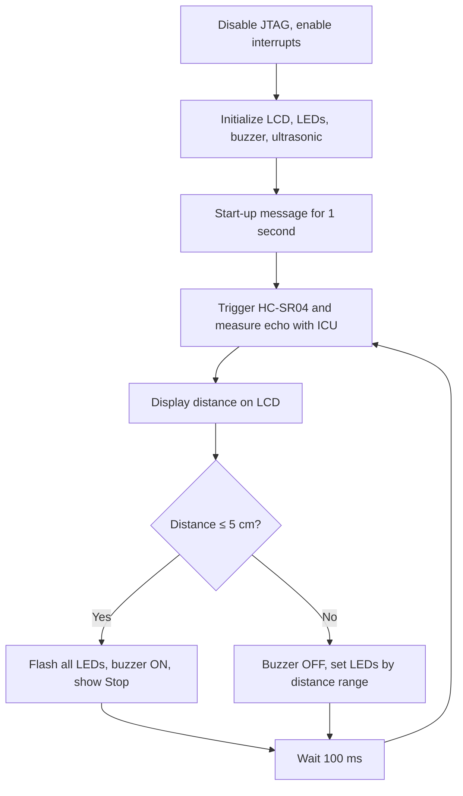

# Car Parking Sensor — ATmega32


A car parking assistant built on the **AVR ATmega32**. An **HC-SR04 ultrasonic sensor**
measures the distance to the nearest obstacle, the distance is shown live on a
**16x2 LCD**, and three **LEDs** plus a **buzzer** give progressive visual and audible
warnings as the car gets closer, all on bare-metal C with layered, reusable drivers.

---

## Table of Contents

- [Features](#features)
- [System Overview](#system-overview)
- [Hardware Components](#hardware-components)
- [Pin Configuration](#pin-configuration)
- [Wiring Details](#wiring-details)
- [System Behavior](#system-behavior)
- [How the Distance Is Measured](#how-the-distance-is-measured)
- [Software Architecture](#software-architecture)
- [Project Structure](#project-structure)
- [Build and Flash](#build-and-flash)
- [Driver Configuration](#driver-configuration)

---

## Features

- **Ultrasonic distance measurement**: the echo pulse is timed in hardware with the Timer1 **Input Capture Unit (ICU)**, interrupt-driven, at 0.5 µs resolution.
- **Live LCD display**: the distance in centimeters is shown and updated about 10 times per second, and `Stop` appears when the obstacle is 5 cm away or closer.
- **Progressive LED warning**: Red, Green and Blue LEDs light up step by step as the obstacle gets closer, and all of them flash in the danger zone.
- **Buzzer alert**: sounds when the distance is 5 cm or less.
- **Layered driver design**: MCAL drivers (GPIO, ICU) are separated from the hardware drivers (LCD, LEDs, buzzer, ultrasonic), and every pin is configurable from the header files.

---

## System Overview



---

## Hardware Components

| Component | Qty | Purpose |
|---|:---:|---|
| ATmega32 microcontroller | 1 | Main controller |
| 16 MHz crystal + 2 x 22 pF capacitors | 1 | System clock |
| HC-SR04 ultrasonic sensor | 1 | Distance measurement (2 cm – 4 m) |
| 16x2 character LCD (HD44780) | 1 | Distance display, 4-bit mode |
| LEDs (Red, Green, Blue) + 330 Ω resistors | 3 | Visual warning |
| Buzzer | 1 | Audible warning |
| NPN transistor (e.g. BC547 / 2N2222) + 1 kΩ base resistor | 1 | Buzzer driver |
| 10 kΩ potentiometer | 1 | LCD contrast |

---

## Pin Configuration

### Full pin map

| MCU Pin | Port.Bit | Direction | Connected To | Driver |
|:---:|:---:|:---:|---|---|
| 39 | **PA1** | Output | LCD **RS** | `lcd.c` |
| 38 | **PA2** | Output | LCD **E** (Enable) | `lcd.c` |
| 37 | **PA3** | Output | LCD **D4** | `lcd.c` |
| 36 | **PA4** | Output | LCD **D5** | `lcd.c` |
| 35 | **PA5** | Output | LCD **D6** | `lcd.c` |
| 34 | **PA6** | Output | LCD **D7** | `lcd.c` |
| 22 | **PC0** | Output | **Red** LED | `LED.c` |
| 23 | **PC1** | Output | **Green** LED | `LED.c` |
| 24 | **PC2** | Output | **Blue** LED | `LED.c` |
| 27 | **PC5** | Output | Buzzer transistor (base) | `buzzer.c` |
| 20 | **PD6** (ICP1) | Input | HC-SR04 **ECHO** | `icu.c` / `ultrasonic.c` |
| 21 | **PD7** | Output | HC-SR04 **TRIG** | `ultrasonic.c` |

> **Note:** PC2–PC5 are shared with the ATmega32 JTAG interface, which is enabled by default.
> The application disables JTAG in software at start-up (`Disable_JTAG()` in `CarParking.c`),
> so the Blue LED (PC2) and the buzzer (PC5) work without changing the fuses.

### Power and clock pins

| MCU Pin | Name | Connection |
|:---:|---|---|
| 10 | VCC | +5 V |
| 11, 31 | GND | Ground |
| 30 | AVCC | +5 V |
| 12, 13 | XTAL2, XTAL1 | 16 MHz crystal, each pin with 22 pF to GND |
| 9 | RESET | 10 kΩ pull-up to +5 V |

---

## Wiring Details

### HC-SR04 ultrasonic sensor

| HC-SR04 Pin | Connect To |
|---|---|
| VCC | +5 V |
| TRIG | PD7 |
| ECHO | PD6 (ICP1) |
| GND | GND |

### LCD (4-bit mode)

| LCD Pin | Signal | Connect To |
|:---:|---|---|
| 1 | VSS | GND |
| 2 | VDD | +5 V |
| 3 | V0 (contrast) | 10 kΩ potentiometer wiper |
| 4 | RS | PA1 |
| 5 | RW | GND (write only) |
| 6 | E | PA2 |
| 7–10 | D0–D3 | Not connected (4-bit mode) |
| 11 | D4 | PA3 |
| 12 | D5 | PA4 |
| 13 | D6 | PA5 |
| 14 | D7 | PA6 |
| 15, 16 | LED+ / LED- | Backlight (+5 V through a resistor / GND) |

### LEDs and buzzer

| Device | Connection |
|---|---|
| Red LED | PC0 → 330 Ω → LED anode, cathode → GND |
| Green LED | PC1 → 330 Ω → LED anode, cathode → GND |
| Blue LED | PC2 → 330 Ω → LED anode, cathode → GND |
| Buzzer | PC5 → 1 kΩ → NPN base, emitter → GND, buzzer between +5 V and collector |

---

## System Behavior

| Distance | Red | Green | Blue | Buzzer | LCD Row 2 |
|:---:|:---:|:---:|:---:|:---:|:---:|
| ≤ 5 cm | Flashing | Flashing | Flashing | **ON** | `Stop` |
| 6 – 10 cm | ON | ON | ON | OFF | — |
| 11 – 15 cm | ON | ON | OFF | OFF | — |
| 16 – 20 cm | ON | OFF | OFF | OFF | — |
| > 20 cm | OFF | OFF | OFF | OFF | — |

### LCD layout

```
+----------------+
|Distance=4 cm   |   Row 0: live distance
|      Stop      |   Row 1: warning (only at 5 cm or less)
+----------------+
```

### Main loop



---

## How the Distance Is Measured

1. `Ultrasonic_Trigger()` sends a **10 µs** HIGH pulse on TRIG (PD7).
2. The HC-SR04 sends an ultrasonic burst and raises **ECHO** until the reflection returns.
3. The **ICU** captures the **rising edge** (Timer1 is reset to 0) and then the **falling edge** (Timer1 value saved from `ICR1`), and this happens inside the interrupt callback `Ultrasonic_edgeProcessing()`.
4. Timer1 runs at `F_CPU / 8` = **2 MHz** (0.5 µs per tick), so:

```
Distance (cm) = ticks × 17150 / (F_CPU / 8)        ≈ ticks / 117 at 16 MHz
```

where 17150 cm/s is half the speed of sound (the pulse travels to the obstacle and back).
If no echo arrives within 40 ms, the last valid distance is kept.

---

## Software Architecture

```
+-----------------------------------------------------------+
|                 Application  (CarParking.c)                |
+-----------------------------------------------------------+
|  HAL:      LCD   |   LED   |   Buzzer   |   Ultrasonic     |
+-----------------------------------------------------------+
|  MCAL:            GPIO             |          ICU          |
+-----------------------------------------------------------+
|                   ATmega32 Hardware                         |
+-----------------------------------------------------------+
```

| Layer | Module | Responsibility |
|---|---|---|
| MCAL | `gpio` | Pin/port direction, read and write |
| MCAL | `icu` | Timer1 Input Capture: edge selection, captured value, callback on interrupt |
| HAL | `ultrasonic` | HC-SR04 trigger, echo timing via ICU, distance in cm |
| HAL | `lcd` | HD44780 LCD, configurable 4/8-bit mode and 2x16/4x16 size |
| HAL | `LED` | Red/Green/Blue LEDs, positive or negative logic selectable at compile time |
| HAL | `buzzer` | Buzzer on/off through a transistor |
| Common | `std_types`, `common_macros` | Shared types and bit-manipulation macros |

---

## Project Structure

```
Car_parking_sensor/
├── CarParking.c           # Application: main loop and warning logic
│
├── gpio.c / gpio.h        # MCAL: GPIO driver
├── icu.c / icu.h          # MCAL: ICU (Timer1 input capture) driver
│
├── ultrasonic.c / .h      # HAL: HC-SR04 ultrasonic driver
├── lcd.c / lcd.h          # HAL: LCD driver
├── LED.c / LED.h          # HAL: LED driver
├── buzzer.c / buzzer.h    # HAL: Buzzer driver
│
├── std_types.h            # Common data types
└── common_macros.h        # Bit-manipulation macros
```

---

## Build and Flash

**Requirements**

- Eclipse IDE for C/C++ with the AVR Eclipse plugin
- AVR-GCC toolchain (WinAVR)
- AVRDUDE and a programmer (for real hardware), or Proteus (for simulation)

**Project settings**

| Setting | Value |
|---|---|
| MCU | ATmega32 |
| CPU frequency (F_CPU) | 16000000 Hz |
| Optimization | -Os |

**Steps**

1. Import the project into Eclipse: *File → Import → Existing Projects into Workspace*.
2. Check *Project → Properties → AVR → Target Hardware*: **ATmega32**, **16000000 Hz**.
3. Build the project; the output `Car_parking_sensor.hex` is generated in the `Debug/` folder.
4. Flash the hex file with AVRDUDE, or load it into the ATmega32 in Proteus with the clock set to 16 MHz.

---

## Driver Configuration

Pins and options are defined as macros in the header files, so the hardware can be
re-mapped without changing any driver code:

| What to change | File | Macro(s) |
|---|---|---|
| Ultrasonic trigger pin | `ultrasonic.h` | `ULTRASONIC_TRIGGER_PORT_ID`, `ULTRASONIC_TRIGGER_PIN_ID` |
| Distance correction / echo timeout | `ultrasonic.h` | `ULTRASONIC_DISTANCE_OFFSET_CM`, `ULTRASONIC_TIMEOUT_STEPS` |
| LED pins and wiring logic | `LED.h` | `RED/GREEN/BLUE_LED_PORT_ID`, `RED/GREEN/BLUE_LED_PIN_ID`, `LED_CONNECTION` |
| Buzzer pin | `buzzer.h` | `BUZZER_PORT_ID`, `BUZZER_PIN_ID` |
| LCD pins, data mode (4/8-bit), size | `lcd.h` | `LCD_RS_PIN_ID`, `LCD_E_PIN_ID`, `LCD_DB4..7_PIN_ID`, `LCD_DATA_BITS_MODE`, `LCD_ROWS` |
| Warning distances / update rate | `CarParking.c` | `DISTANCE_STOP_CM`, `DISTANCE_LEVEL1..3_CM`, `MEASUREMENT_PERIOD_MS` |

> The ECHO pin is fixed to **PD6 (ICP1)** because it is the only Timer1 input-capture pin on the ATmega32.
